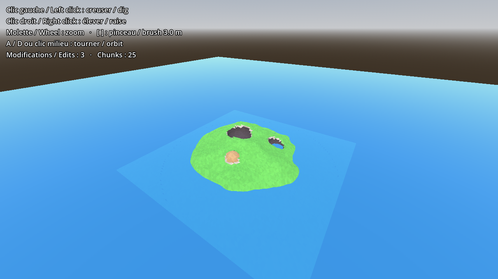

# Surface Nets Terrain for Godot 4

**Smooth, diggable voxel terrain in pure GDScript.** No engine module, no custom Godot build, no C++.
Drop the addon in, give it a density (or height) function, and dig or raise the ground at runtime.

*Terrain voxel lisse et creusable, en GDScript pur. Version française plus bas.*



## Why

The best-known voxel solution for Godot is an engine module, which means using a special build of the editor.
This addon is a single GDScript class that works in the standard Godot download. It is meant for
small to medium worlds: islands, arenas, prototypes, game jams, destructible levels.

## Features

- **Surface nets** meshing (a cousin of marching cubes): smooth, faceted low-poly look, or smooth normals.
- **Dig and raise** spheres at runtime with `edit()`.
- **Chunked**: an edit only rebuilds the chunks it touches (about 25 ms for a 3 m dig, see below).
- **Collision included** (`ConcavePolygonShape3D` per chunk): physics and raycasts work right away.
- **Replayable edit log** (`edits`, `replay()`): a late-joining player, a save file or a server can rebuild
  exactly the same terrain. The `edited` signal gives you what to send over the network.
- **Your own world**: any density function `func(p: Vector3) -> float`, or a heightmap via `from_heightmap()`.
- **Vertex colours** out of the box (grass, rock on slopes, dug and raised earth), or your own `color_function`,
  or your own `material`.

## Install

1. Copy `addons/surface_nets_terrain` into your project's `addons/` folder.
2. (Optional) Enable **Surface Nets Terrain** in *Project Settings > Plugins*.
3. Add a `SurfaceNetsTerrain` node, or create it from code.

Tested with Godot 4.5. Written for Godot 4.3 and later.

## Quick start

```gdscript
var terrain := SurfaceNetsTerrain.new()
terrain.grid_size = Vector3i(64, 24, 64)   # grid points
terrain.voxel_size = 1.0                    # metres
terrain.density_function = SurfaceNetsTerrain.from_heightmap(
	func(x: float, z: float) -> float: return 8.0 + sin(x * 0.2) * 2.0)
add_child(terrain)

# Later, from a raycast hit:
terrain.edit(hit.position, 3.0, false)   # dig a 3 m sphere
terrain.edit(hit.position, 2.0, true)    # raise a 2 m mound
```

### Multiplayer in three lines

```gdscript
terrain.edited.connect(func(center, radius, add): rpc("remote_edit", center, radius, add))

@rpc("any_peer", "reliable") func remote_edit(center, radius, add):
	terrain.edit_local(center, radius, add)
```

For a player who joins late, send `terrain.edits` once and call `terrain.replay(edits)` on their side.

## API

| Member | Description |
|---|---|
| `grid_size: Vector3i` | Number of grid points on each axis. |
| `voxel_size: float` | Size of one voxel, in metres. |
| `chunk_cells: int` | Cells per chunk side (default 16). |
| `flat_shading: bool` | Faceted low-poly look (default) or smooth normals. |
| `material: Material` | Optional. Default: vertex-colour material. |
| `generate_collision: bool` | Build collision shapes (default true). |
| `generate_on_ready: bool` | Generate automatically on `_ready` (default true). |
| `density_function: Callable` | `func(p: Vector3) -> float`, local metres, positive = solid. |
| `color_function: Callable` | Optional `func(center, normal, original_density) -> Color`. |
| `edits: Array` | Edit log, entries `[center, radius, add]` in local space. |
| `generate()` | (Re)builds everything, then replays `edits`. |
| `edit(global_center, radius, add)` | Dig (`add = false`) or raise (`add = true`) a sphere. |
| `edit_local(center, radius, add)` | Same, in local space (best for networking). |
| `replay(log)` | Rebuilds the terrain from an edit log. |
| `is_solid(global_pos)` / `get_density(global_pos)` | Query the matter. |
| `from_heightmap(height)` *(static)* | Turns `func(x, z) -> height` into a density function. |
| `signal edited(center, radius, add)` | After each edit. |
| `signal chunk_rebuilt(chunk)` | After a chunk mesh is rebuilt. |

## Performance

Measured headless on a 2-core cloud machine with Godot 4.5:

| Grid | Full generation | Dig, 3 m radius |
|---|---|---|
| 64 × 24 × 64 | about 170 ms | about 25 ms |
| 128 × 32 × 128 | about 0.8 s | about 25 ms |

Edit cost depends on the brush size, not the world size. The whole density grid stays in memory,
so this addon is not meant for endless streaming worlds.

## Demo and tests

- Open the project and press **F5**: left click digs, right click raises, `[` `]` change the brush, A/D or middle mouse orbit.
- Headless tests: `godot --headless --path . --script res://tests/test_headless.gd`

## Origin

Extracted from the prototype of **Eternal Burden : Blood and Wisdom**, where comets and spells dig real craters.

## License

MIT, see [LICENSE](LICENSE).

---

# Version française

**Terrain voxel lisse et creusable, en GDScript pur.** Aucun module, aucune version spéciale de Godot, aucun C++.
On ajoute l'addon, on lui donne une fonction de densité (ou de hauteur), et on creuse ou on élève le sol en jeu.

## Pourquoi

La solution voxel la plus connue pour Godot est un module du moteur : il faut une version spéciale de l'éditeur.
Cet addon est une seule classe GDScript qui fonctionne avec le Godot standard. Il vise les petits et moyens mondes :
îles, arènes, prototypes, game jams, niveaux destructibles.

## Ce qu'il fait

- Maillage **surface nets** (cousin du marching cubes) : style low poly à facettes, ou normales lisses.
- **Creuser et élever** des sphères en jeu avec `edit()`.
- **Découpage en morceaux** : une modification ne reconstruit que les morceaux touchés (environ 25 ms pour un trou de 3 m).
- **Collisions incluses** : la physique et les rayons fonctionnent tout de suite.
- **Journal des modifications rejouable** (`edits`, `replay()`) : un joueur qui arrive en retard, une sauvegarde
  ou un serveur reconstruit exactement le même terrain. Le signal `edited` donne ce qu'il faut envoyer sur le réseau.
- **Ton propre monde** : n'importe quelle fonction de densité, ou une carte de hauteur avec `from_heightmap()`.
- **Couleurs** prêtes à l'emploi (herbe, roche des pentes, terre creusée, terre soulevée), ou ta propre `color_function`,
  ou ton propre `material`.

## Installation

1. Copie `addons/surface_nets_terrain` dans le dossier `addons/` de ton projet.
2. (Facultatif) Active **Surface Nets Terrain** dans *Paramètres du projet > Extensions*.
3. Ajoute un nœud `SurfaceNetsTerrain`, ou crée-le dans le code (voir l'exemple plus haut).

Testé avec Godot 4.5. Écrit pour Godot 4.3 et plus récent.

## Démo et tests

- Ouvre le projet et appuie sur **F5** : clic gauche pour creuser, clic droit pour élever, `[` `]` pour la taille du pinceau,
  A/D ou clic milieu pour tourner.
- Tests sans écran : `godot --headless --path . --script res://tests/test_headless.gd`

## Origine

Tiré du prototype d'**Eternal Burden : Blood and Wisdom**, où les comètes et les sorts creusent de vrais cratères.

## Licence

MIT, voir [LICENSE](LICENSE).
